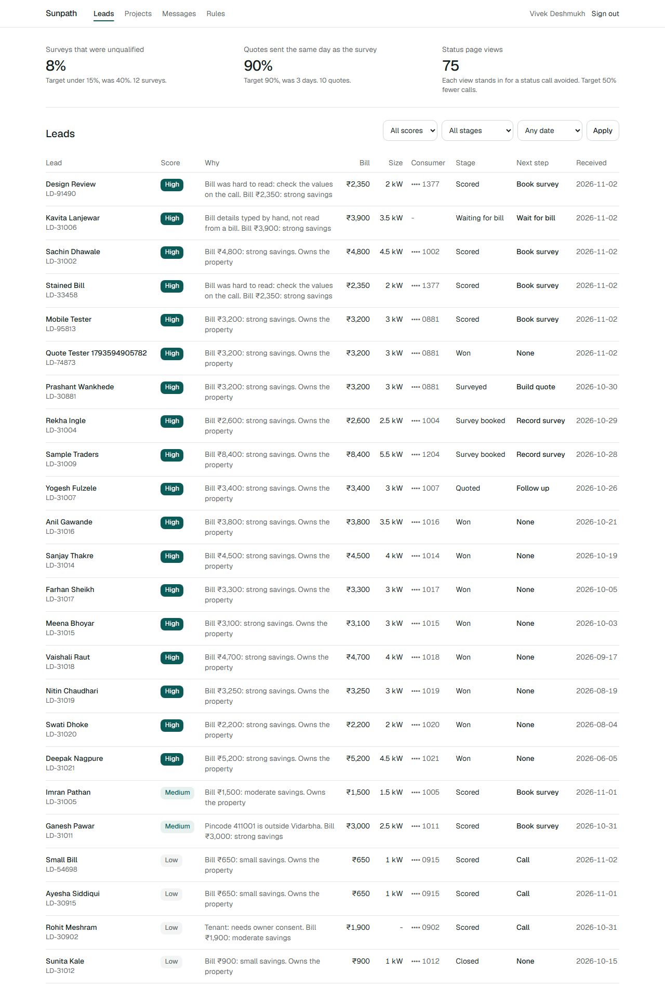

# Sunpath

From a rooftop solar enquiry to the subsidy landing in the bank. Built for a Vidarbha solar installer that runs on WhatsApp and Excel: homeowners answer a few questions and upload a bill, AI reads it, sales sees who is worth a visit and what size fits, and the quote goes out the same day as the survey.

**Live app: https://sunpath-virid.vercel.app**

## Demo logins

| Role | Login | Password |
|---|---|---|
| Sales | `sales@sunpath.demo` | `sales-demo-1` |
| Admin | `admin@sunpath.demo` | `admin-demo-1` |
| Homeowner | `9000030881` | `home-demo-1` |

## How to review this in 60 seconds

1. **Be a homeowner.** Open the [live app](https://sunpath-virid.vercel.app) on your phone. Answer the questions, then pick **Clear home bill** under "Trying this out?". Samples answer at once from a saved reading, so they use no AI quota. To see Gemini read a bill live, in about 10 seconds, upload your own instead (5 a day per network). Confirm the values and see the result. Try **Tilted, stained photo** to see doubtful fields highlighted, and **Blurry photo** for the re-upload prompt.
2. **See the quote story.** Open [a sample quote](https://sunpath-virid.vercel.app/en/q/demo-quote-ld-31007), then the same one [in Marathi](https://sunpath-virid.vercel.app/mr/q/demo-quote-ld-31007). Open "How we calculated this" and download the PDF.
3. **Be sales.** [Sign in](https://sunpath-virid.vercel.app/en/login) as Sales and open **Prashant Wankhede**. Change the tariff and watch the numbers update, then send the quote. Check **Messages** for the mock WhatsApp, and **Projects** for the stuck dashboard.
4. **See a customer's project.** Open [a status page](https://sunpath-virid.vercel.app/mr/s/demo-status-pr-1002).
5. **Change the rules.** Sign in as Admin and open **Rules**. Try adding a subsidy rule with overlapping dates.

6. **Try what they didn't ask for.**
   - On the upload step, pick **Marathi home bill**: it reads the real MSEDCL layout, then shows a year of bills before and after solar.
   - Pick **May bill**: it spots a peak month and sizes on the year. Pick **Bill in another name**: it catches the name, the arrears and the low load before anyone visits.
   - Tap **Measure your roof on a map** in the form. Open [a quote](https://sunpath-virid.vercel.app/mr/q/demo-quote-ld-31007) and save the family card.
   - On [a finished project](https://sunpath-virid.vercel.app/en/s/demo-status-pr-1008), add **Bill after solar**. As Sales, **Projects** shows who is likely to slip and whose savings are behind.

The live data is shared, so someone else may have already quoted Prashant.

## What is real and what is mocked

| Real | Mocked or assumed |
|---|---|
| Gemini bill reading, including poor-photo and outage handling | WhatsApp and SMS: rows in an outbox, shown in the app |
| Subsidy, sizing, payback and scoring from dated rule tables | Payments: the advance is recorded with no money moving |
| Auth with server-side role checks, private file storage | Prices are placeholders (A05 in the assumptions) |
| PDF quotes in English, Marathi and Hindi | Sample bills are fictional, stamped SAMPLE and never pass as real bills |
| Bill reading measured on 5 real MSEDCL bills: [95% of fields](docs/BILL_ACCURACY.md) | That test is small. Accuracy on thousands of phone photos needs a pilot |
| Tariff engine that matches real bills to the paisa | Completion forecasts and delivered savings run on seed data |

## Where to look

| | |
|---|---|
| The hard part: pure, tested rules and maths | [src/domain](src/domain) |
| AI reader and its failure handling | [src/server/bill-reader](src/server/bill-reader) |
| Design and reasoning | [docs/TDD.md](docs/TDD.md) |
| Read accuracy on real bills | [docs/BILL_ACCURACY.md](docs/BILL_ACCURACY.md) |
| Every assumption, with IDs | [docs/ASSUMPTIONS.md](docs/ASSUMPTIONS.md) |
| Run it yourself | [deployment.md](deployment.md) |
| Sample bills, served at `/samples` | [public/samples](public/samples) |

## Stack

Next.js 16, TypeScript, Tailwind, shadcn/ui, Postgres on Neon, Prisma, Auth.js, Vercel Blob, Gemini, react-pdf, next-intl, Vitest and Playwright. Everything runs on free tiers.

`pnpm submission` builds `submission.zip` with `TDD.pdf` and `deployment.md`.
