# Sunpath: Technical Design Document

**GitHub:** https://github.com/Divyam1909/sunpath
**Live app:** https://sunpath-virid.vercel.app

Sunpath takes a rooftop solar lead in Vidarbha from enquiry to subsidy credited. It was built for Company A's brief: stop spending survey visits on people who will never buy, and get a quote out the same day as the survey.

## 1. Problem and success metrics

Company A (Nagpur, 75 staff, about 120 installations a month) runs on WhatsApp and Excel. Sales calls every lead, asks for a bill photo, sends a surveyor, and builds the quote in a spreadsheet over three days. Subsidy and net-metering sit in another sheet.

On the client's own assumptions, of 1,400 leads a month, 350 are genuine.

| Cost | Client's figure | What it implies |
|---|---|---|
| 40% of 220 monthly surveys go to people who were never going to buy | ₹26.4 lakh a year | 88 wasted surveys a month at about ₹2,500 each |
| 4% of genuine leads (14 a month) go to faster rivals | ₹60.48 lakh a year | About ₹36,000 lost per sale |
| **Total** | **₹86.88 lakh a year** | |

The larger cost is the slow quote, not the wasted survey, so same-day quoting matters at least as much as scoring.

| Success metric | From | Target | How the app measures it |
|---|---|---|---|
| Unqualified surveys | 40% | Under 15% | The surveyor marks each visit qualified or not |
| Same-day quotes | 3 days | 90% of surveys | First quote sent on the survey's Indian calendar day |
| Status calls | Baseline unknown | Down 50% | Status page views, as a stand-in |

These three appear on the sales dashboard from live records. **The figures on the demo come from seed data, so they show the panel working, not a result.** Real baselines would come from a pilot.

## 2. Architecture

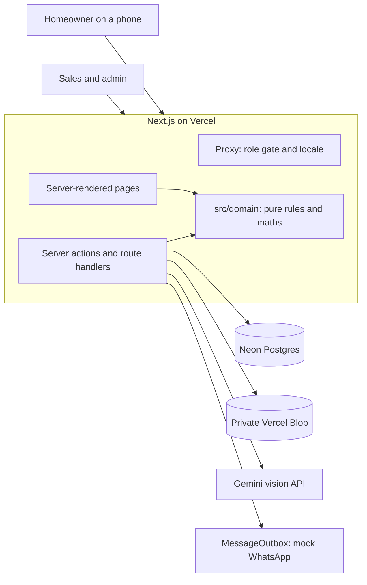

**Why this shape.** A ₹6 lakh, six-week build for a 75-person company needs one deployable and no servers to run, so it is a single Next.js app on free tiers.

- **Pure domain layer.** All maths lives in `src/domain` as functions with no I/O. This is the most important decision in the codebase. It makes the subsidy and payback rules testable and explainable, and the quote builder runs the same code in the browser for live numbers. The server then recomputes everything, so browser figures are never trusted.
- **Rule tables, not code.** Subsidy, prices and thresholds live in the database because the brief says they change.
- **Interfaces at the edges.** `BillReader` and `FileStore` each have a real and a fake implementation, so tests, CI and local work need no accounts.
- **Outbox for messages.** Every message is a row. Moving to the real WhatsApp Business API means adding a sender that drains the table, with no change to business logic.

Cache Components are switched off. Nearly every page shows live data, so the plain dynamic model is simpler. Next.js `proxy.ts` handles the first role check, and every action repeats it.

## 3. Data model

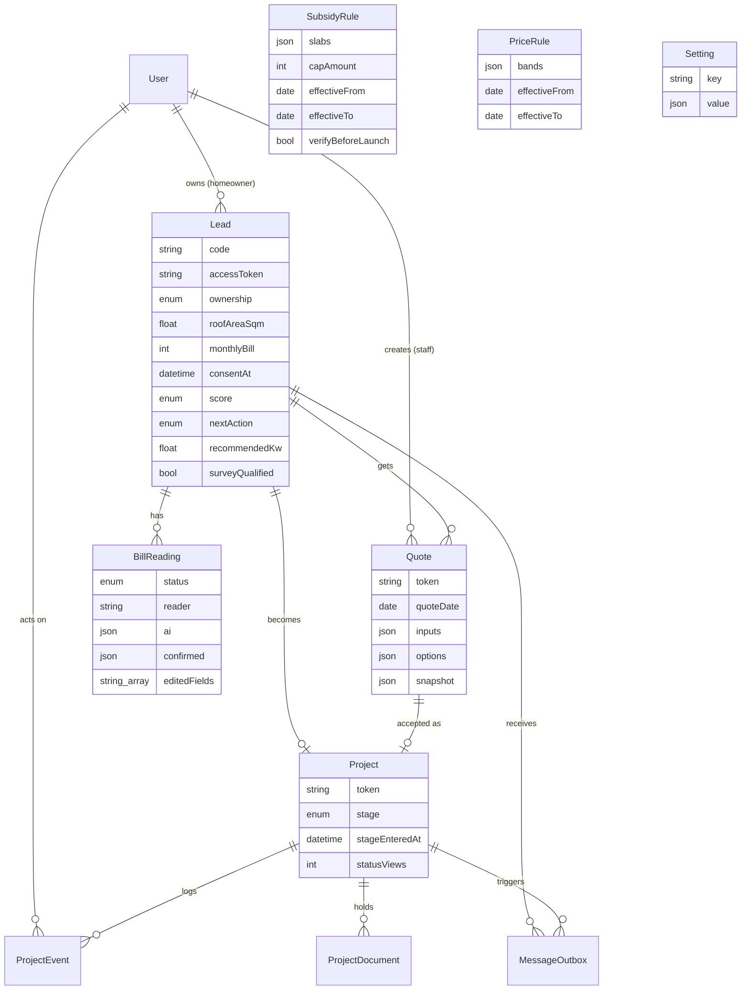

Decisions worth defending:

- **`BillReading` keeps `ai` and `confirmed` side by side**, plus `editedFields`. This is the audit trail for measuring AI accuracy later.
- **`Quote.snapshot` copies the rules used.** There is no foreign key to a rule on purpose: a later edit cannot reach an old quote. An E2E test proves it.
- **Money is whole rupees, dates in rule tables are date-only**, and "same day" means the Indian calendar day.
- **`RateLimit` is a table**, because in-memory counters do not survive across serverless instances.

## 4. Main flows

### Lead to bill read to score

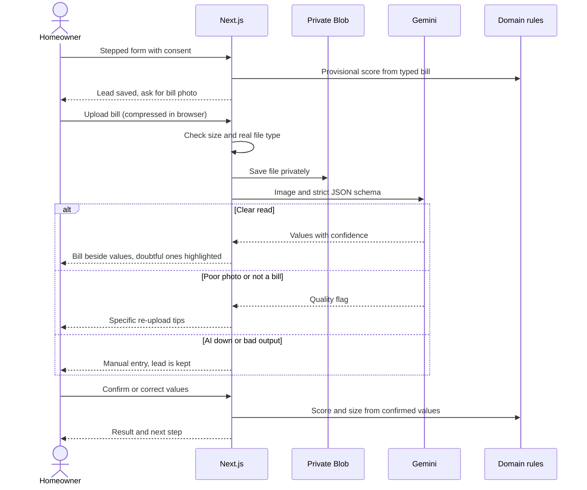

### Quote to advance to project

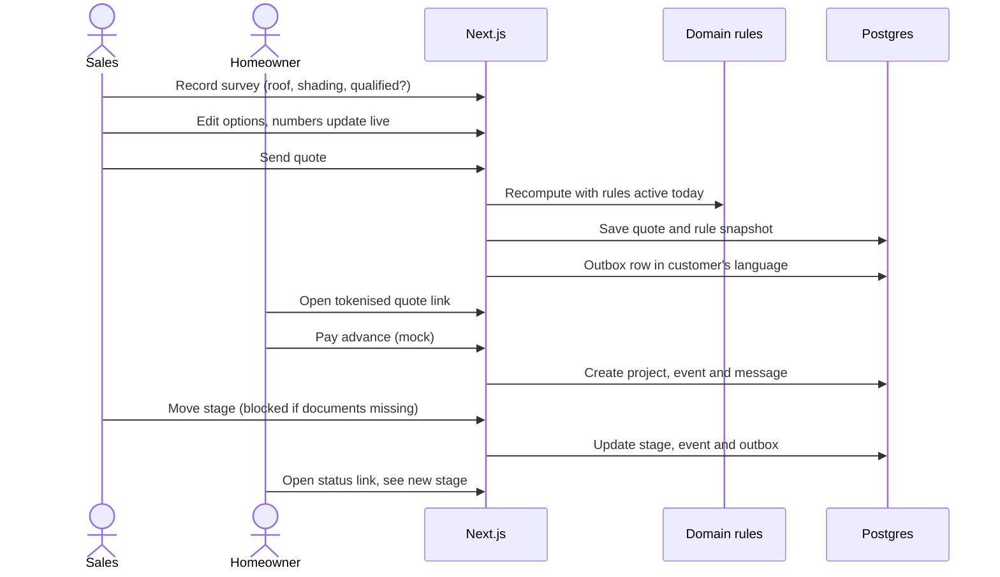

## 5. How the AI works and how it fails safely

The AI does one job: it reads a bill. It never sets a price, a subsidy, generation or a score.

**Reading.** `GeminiBillReader` sends the image with a strict response schema. The model returns a value and a confidence per field, plus `isElectricityBill` and an image-quality flag. The prompt forbids estimating, tells the model to return null for anything it cannot see, and treats text in the image as data, which guards against prompt injection from an uploaded image. Zod then validates the reply again in `parseBillResponse`.

**Tested on the real API.** All six samples went through `gemini-3.5-flash`. The three clear bills gave every value correctly in about 6 seconds. On the deliberately stained bill the model read the rest and returned null for the two hidden fields rather than guessing. The blurry photo and the shop receipt were both rejected. This is synthetic data only: **accuracy on real MSEDCL phone photos is unmeasured** and is the first thing to check in a pilot.

| Failure | What the app does |
|---|---|
| Unsure of a value | The value is highlighted beside the zoomable bill for a person to confirm |
| Value not found | Left blank, never guessed |
| Blurry, cropped, dark or not a bill | A specific message with photo tips and a re-upload |
| Model returns bad JSON or wrong shape | Treated as a failed read, then manual entry |
| API down, over quota, or no key | The lead is kept, with a clear message and manual entry |
| Model wrong but confident | A person sees every value before it is used, and corrections are stored |
| Low score | A short call replaces the visit. Only a person can close a lead |

A fallback chain keeps the demo alive: if Gemini fails on a known sample, the deterministic `MockBillReader` answers and the record says `mock`. It recognises samples by SHA-256 and refuses anything else, so it can never invent values for a real bill. Model confidence is uncalibrated, so the 75% threshold (A13) is a starting point.

## 6. Subsidy and payback maths

The subsidy comes from an admin table, and generation from a fixed formula. Neither comes from AI.

**Rule selection.** The engine picks the rule active on the quote date, with both end dates inclusive. Rules for the same segment cannot overlap, which is checked on save and tested. Commercial tariffs get no subsidy, because the stated scheme is residential (A20).

**Scoring.** Points out of 100 (A09): owner 25; bill of ₹2,000 or more 30, or ₹1,000 to ₹1,999 10; roof fits the need 20, or part of it 10; inside Vidarbha 15; clear bill read 10. High is 90 or more, Medium 50 or more. Tenants and bills under ₹1,000 are held at Low whatever the total.

### Worked example: LD-30881, Prashant Wankhede

Owner, ₹3,200 bill, 340 units a month, 600 sq ft roof, 5 kW sanctioned load.

| Step | Calculation | Result |
|---|---|---|
| Yearly use | 340 × 12 | 4,080 units |
| Size needed | 4,080 ÷ 1,400 = 2.91, rounded to nearest 0.5 kW | 3 kW |
| Roof cap | 55.7 m² ÷ 10 m² per kW | 5.5 kW, no limit |
| Load cap | Sanctioned load | 5 kW, no limit |
| Score | 25 + 30 + 20 + 15 + 10 | 100, High, book survey |
| Gross cost (assumed price, A05) | 3 kW × ₹65,000 | ₹1,95,000 |
| Subsidy | 2 × ₹30,000 + 1 × ₹18,000 | ₹78,000 |
| Net cost | ₹1,95,000 − ₹78,000 | ₹1,17,000 |
| Yearly generation | 3 × 1,400 | 4,200 units |
| Tariff | ₹3,200 ÷ 340 (no single rate printed) | ₹9.41 per unit |
| Units offset | Lower of 4,200 and 4,080 | 4,080 units |
| Surplus | 4,200 − 4,080, credited at ₹3 | 120 units |
| Yearly savings | 4,080 × ₹9.41 + 120 × ₹3 | ₹38,753 |
| Payback | ₹1,17,000 ÷ ₹38,753 | 3.0 years |
| 25-year savings | ₹38,753 × 25 − ₹1,17,000 | ₹8,51,825 |

Options one step either side:

| | 2 kW | 3 kW | 4 kW |
|---|---|---|---|
| Net cost | ₹80,000 | ₹1,17,000 | ₹1,62,000 |
| Yearly savings | ₹26,348 | ₹38,753 | ₹42,953 |
| Payback | 3.0 years | 3.0 years | 3.8 years |

The 4 kW row shows why the surplus rate matters. Valuing every unit at full tariff would make oversizing look better than it is. Here the extra 1,400 units earn only ₹3 each.

**Subsidy at each size:** 1 kW ₹30,000; 2 kW ₹60,000; 2.5 kW ₹69,000; 3, 5 and 10 kW ₹78,000. Fractional kW are paid pro rata inside each slab.

**A note on the cap.** With today's slabs, the ₹78,000 cap can never bite: the slabs themselves stop at 3 kW and total exactly ₹78,000. The engine still applies it, so a later rule whose slabs exceed its cap will work.

The other two sample rows also come out as specified: LD-30902 (tenant) gets Low and no size, and LD-30915 (₹650, 85 units) gets 1 kW and Low. `score.test.ts` asserts all three.

## 7. UI and design decisions

The direction is calm and minimal: white space, one deep teal accent, neutral greys, and red kept for "stuck" and errors. Latin text is Geist, with Noto Sans Devanagari for Marathi and Hindi.

- **The form is the hero.** The landing page opens on the first question, because the job is to start the form.
- **The quote is a story.** System size, cost after subsidy and payback come first in very large type. The options, the table and "How we calculated this" follow, for anyone who wants them.
- **The sun's path.** The status page draws the project as a sun crossing the sky, from advance at sunrise to subsidy at sunset. It is the one memorable element and the only motion that plays on its own.
- **Honest emptiness.** Stained fields stay blank and highlighted, rather than showing a guess.
- **Staff screens are dense, homeowner screens are not.** Sales sees reasons, points and the next step in one row.

Every screen was captured at 390 px and 1280 px, then reviewed and corrected. That review found a select overflowing its column, misaligned settings fields, weak "why" text and raw ISO dates, all since fixed.

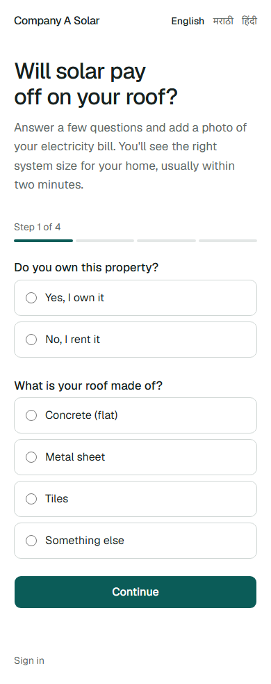{width=180}
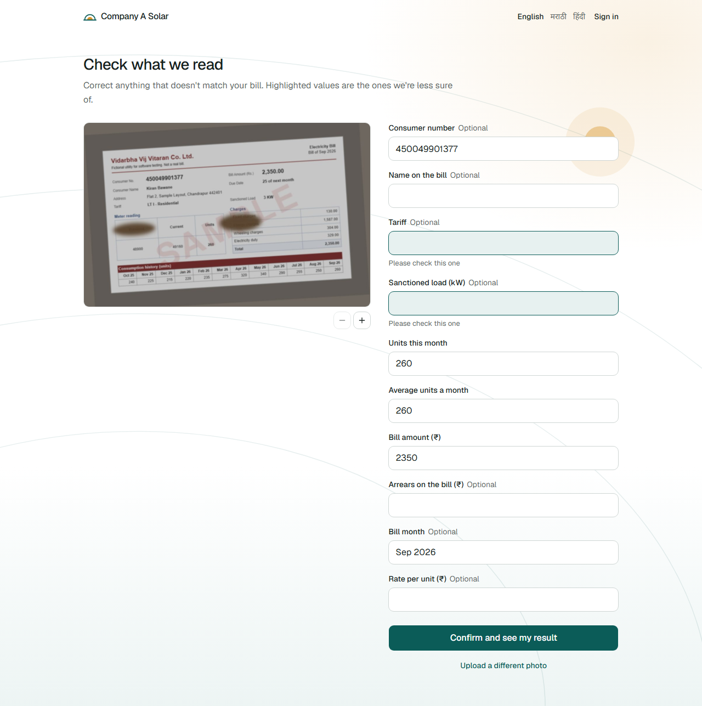{width=470}

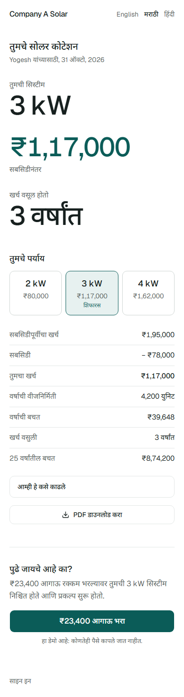{width=180}
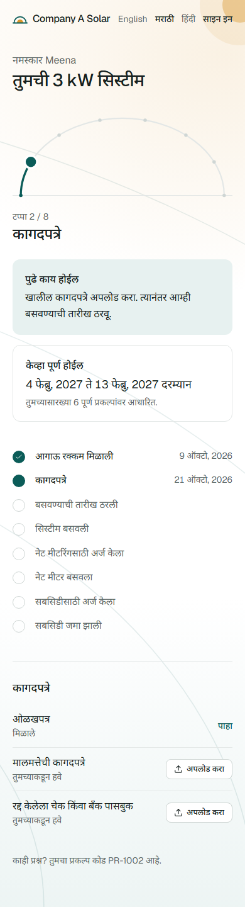{width=180}

{width=640}

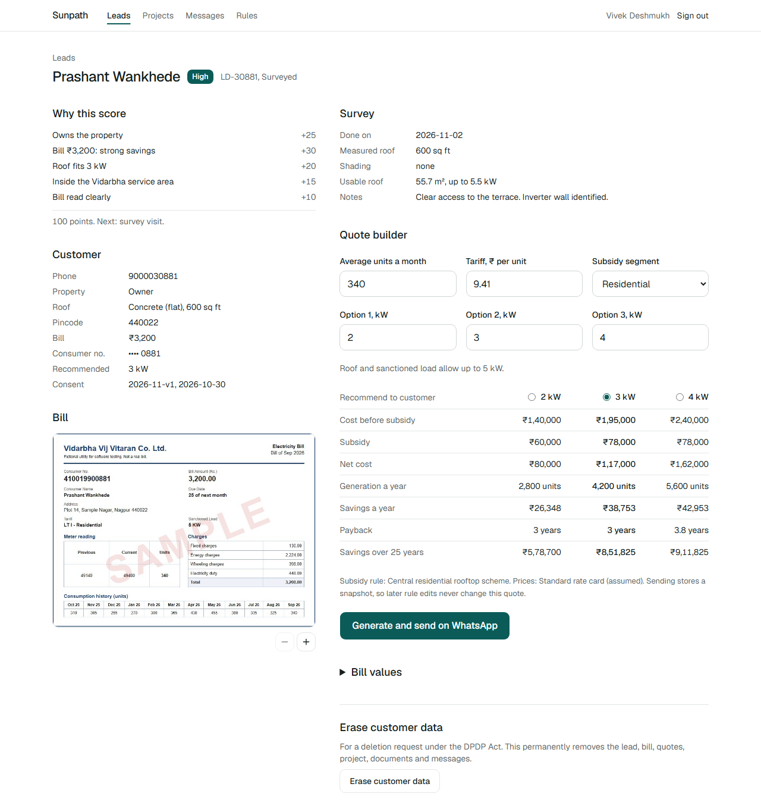{width=640}

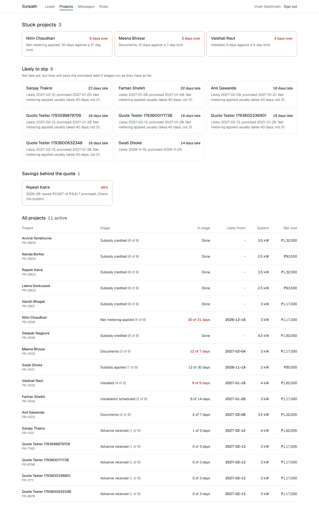{width=640}

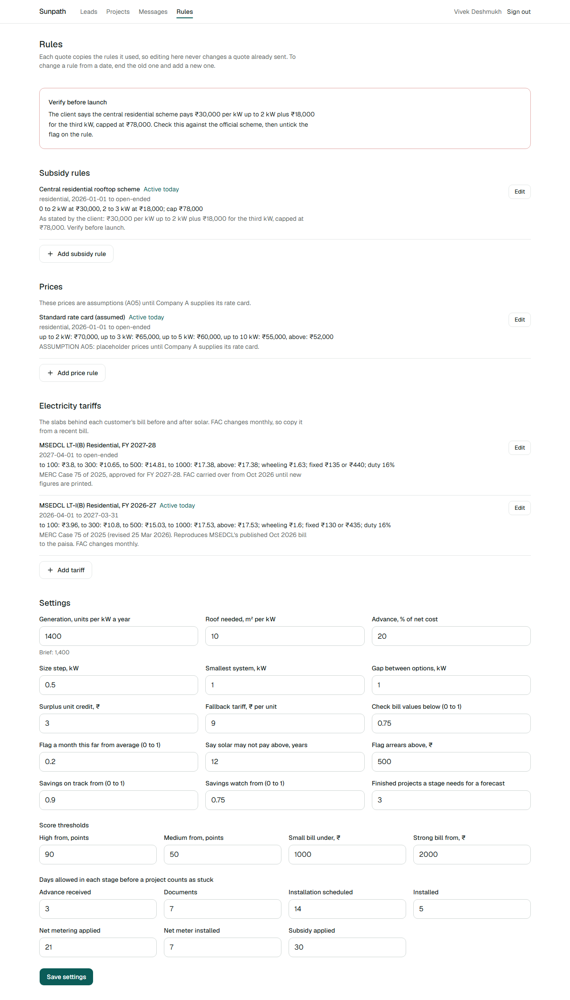{width=640}

## 8. Security and DPDP handling

**Access.** Auth.js with hashed passwords and three roles. The proxy gives a fast redirect, and every server action, route and page checks the role again on the server. Homeowners only ever read leads linked to their own account. Public links carry 192 random bits. Signing in a homeowner never links a lead by phone number alone, because the number is unverified.

**Input.** Zod validates every input, sharing one schema between form and server. Uploads are limited to 4 MB, and the type comes from the file's bytes, not its name. Lead, login, upload and payment routes are rate limited in Postgres. The `next` login redirect accepts same-site paths only.

**Personal data under the DPDP Act 2023.**

| Principle | How it is handled |
|---|---|
| Consent | A plain-language purpose notice and an explicit tick. Timestamp, purpose and version are stored |
| Purpose limit | Only what the quote and project need is collected |
| Minimisation | Lists show the last 4 digits of consumer numbers. Quote and status pages show a first name only, and a test asserts no phone, address or consumer number appears in them |
| Storage | Bills and documents sit in a private store, reachable only through 5-minute signed URLs. An unsigned link returns 403 on the live site |
| Erasure | Admins can erase a customer's lead, files, quotes, project and messages on request |
| Secrets | Only `.env.example` is committed, and the repo has been scanned for keys |

**Retention (A21, for legal review).** Unconverted leads and bills: delete 24 months after last activity. Project records: keep 8 years for tax. Rejected bill photos: delete after 90 days. No automatic deletion job exists yet, so this is policy rather than code today.

**Known gaps, which I would raise before launch.**

- Consumer numbers are stored unencrypted at field level, with only provider encryption at rest.
- Bills go to a third-party AI on Google's free tier, and free-tier data may be used to improve Google's products. A paid tier with a data-processing agreement is needed before real customer bills are sent.
- The demo database sits in `us-east-1` (A22). Production should move to an Indian region.
- A bill's consumer number and any name on it reach Gemini, so the consent notice must name this processor at launch.
- Seeded demo links use readable tokens (A29), and the demo logins are public.

## 9. Testing strategy

The riskiest logic gets the most tests.

| Layer | Tool | Count | Covers |
|---|---|---|---|
| Domain and reader | Vitest | 117 | Subsidy slabs, cap and date selection, overlap rejection, sizing, payback, all three sample rows, bill parser, stuck detector, translation key and placeholder parity |
| End to end | Playwright | 18 | Lead to result on a 390 px phone, re-upload, quote and PDF, stage change to outbox to status page, document gating, old quotes unchanged after rule edits, role and PII checks, erasure |
| CI | GitHub Actions | On every push | Lint, typecheck, unit tests, migrations, seed, build and E2E against Postgres with the mock reader |

Real Gemini is exercised by `scripts/try-gemini.ts` and was also checked through production, not in CI, because CI must not depend on a live API or use a key. Marathi and Hindi PDFs were rendered and inspected by eye, since a test cannot judge glyph shaping.

## 10. All assumptions

<!-- ASSUMPTIONS -->

## 11. What was cut, and why

| Cut | Why |
|---|---|
| Real WhatsApp or SMS | The brief says to mock it. The outbox keeps the seam clean |
| Real payments | The brief says to mock it |
| Filing on the subsidy portal, inventory, inverter monitoring | Out of scope in the brief |
| Survey calendar and surveyor assignment | One date field proves the flow. Scheduling is its own product |
| Phone verification by OTP | Paid SMS. Instead, leads are never linked to accounts by phone alone |
| Automatic retention job | Needs a legal decision on periods first |
| Native-reviewed Marathi and Hindi | No budget in a zero-cost build, so the copy is machine-drafted (A19) |
| Audit log of admin rule edits | Snapshots already protect quotes. Worth adding before launch |

## 12. What I would do next

1. **Pilot on real bills** to measure read accuracy using the stored AI-vs-confirmed values, and tune the confidence threshold.
2. **Real WhatsApp Business API**, draining the existing outbox, with delivery status and customer replies.
3. **DISCOM integrations** for net-metering status where MSEDCL allows it.
4. **Accuracy dashboard**: edits per field, by bill layout.
5. **Offline survey mode**, as roofs often have poor signal.
6. **Move to Indian regions**, a paid AI tier with a data-processing agreement, and field-level encryption for consumer numbers.
7. **Tune the score** against real outcomes: which High leads bought, and which Low leads surprised us.
